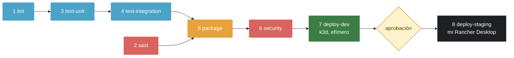

# El pipeline

Ocho jobs encadenados con `needs`. `lint` y `sast` arrancan a la vez; si una etapa falla, las siguientes no corren.

## Qué hace cada etapa

| # | Etapa | Herramienta | Qué revisa | Si falla | Corre en |
|---|---|---|---|---|---|
| 1 | `lint` | ESLint, HTMLHint, Hadolint | Estilo del JavaScript, del HTML y de los tres Dockerfiles | No se ejecuta ninguna prueba | PR y push |
| 2 | `sast` | Semgrep, **TruffleHog** | Patrones peligrosos en el código y secretos en **todo** el historial de Git | No se empaqueta nada | PR y push |
| 3 | `test-unit` | Vitest | La lógica de la API con un pool falso, y el sitio con jsdom | No se prueba la integración | PR y push |
| 4 | `test-integration` | Vitest + Compose | La aplicación entera levantada, entrando por nginx | No se publica ninguna imagen | PR y push |
| 5 | `package` | Buildx, GHCR | Construye y publica `web`, `api` y `db` con el tag del commit | No hay imagen que escanear | PR y push |
| 6 | `security` | Trivy | Vulnerabilidades de la imagen ya publicada | Nada llega a ningún ambiente | PR y push |
| 7 | `deploy-dev` | **k3d** | Despliega en un clúster efímero y corre smoke e integración contra él | No se pide aprobación | solo push a `main` |
| 8 | `deploy-staging` | runner propio | Despliega en mi Rancher Desktop | STAGING se queda como estaba | push a `main`, **tras aprobación** |

## Las dos compuertas

**Técnica:** de `lint` a `deploy-dev` todo es automático, y cualquier fallo detiene la cadena. `main` está protegida con diez checks obligatorios, así que un PR en rojo no se puede mezclar.

**Humana:** `deploy-staging` usa el environment `staging`, que tiene *Required reviewers*. El job se queda esperando hasta que una persona aprueba. Eso es **Continuous Delivery**: para convertirlo en Continuous Deployment bastaría con quitar esa regla, sin tocar una línea del workflow.

## Por qué una imagen y no tres builds

`package` publica las imágenes en GHCR con el tag `sha-<commit>`, y a partir de ahí **nadie vuelve a construir**: `security` escanea esa imagen, `deploy-dev` la despliega y `deploy-staging` despliega exactamente la misma. Si cada etapa reconstruyera, lo escaneado y lo desplegado podrían no ser el mismo binario.

## Herramientas cambiadas respecto de la guía (B2)

| Etapa | La guía usa | Yo uso | Por qué |
|---|---|---|---|
| Secretos | Gitleaks | **TruffleHog 3.99.7** | Además de detectar el patrón, verifica contra el servicio emisor si la credencial sigue viva: separa un secreto explotable de una cadena que solo lo parece |
| DEV | kind | **k3d 2.4.0** | k3d levanta **k3s**, la misma distribución que corre mi Rancher Desktop en STAGING. DEV deja de ser un Kubernetes distinto al de destino |

## Seguridad de la cadena de suministro

- Todas las acciones de terceros van fijadas por **SHA completo**, con el tag como comentario. Un tag se puede mover a otro código; un SHA no. Así se comprometió `tj-actions/changed-files` en 2025.
- El workflow arranca con `permissions: contents: read` y cada job pide solo lo suyo: `packages: write` únicamente en `package`, `packages: read` en `security` y `deploy-dev`.
- Dependabot vigila acciones, npm y las imágenes base, con `cooldown` de 7 días para no saltar a una versión recién publicada.

## Vulnerabilidades: qué se corrige y qué se acepta

Trivy frena ante `CRITICAL` **y** `HIGH` con parche disponible. Las imágenes base traían 45 hallazgos altos; ninguno se escondió bajando la severidad:

| Imagen | Antes | Después | Cómo |
|---|---|---|---|
| `web` | 45 HIGH | **0** | `apk upgrade --no-cache` en el Dockerfile |
| `api` | 11 HIGH | **0** | `apk upgrade` y **eliminar npm de la imagen final**: en ejecución la app solo necesita `node`, y npm arrastraba las vulnerabilidades de sus propias dependencias |
| `db` | 26 HIGH | 26 aceptadas | Todas del binario `gosu` de la imagen oficial de Postgres, documentadas una por una en `.trivyignore` con su motivo |
