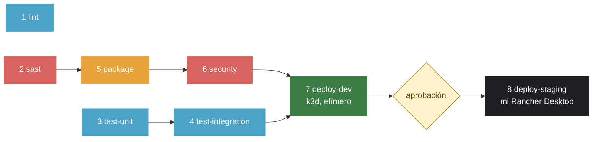

# demo-cicd — Gabriel De la Rivera

[](https://github.com/Gabrieldla/demo-cicd/actions/workflows/ci-cd.yml)

> 📄 **[Cómo funciona el pipeline →](./PIPELINE.md)**: el diagrama, qué hace cada una de las ocho
> etapas, qué pasa si falla, las herramientas que cambié y cómo se tratan las vulnerabilidades.

---

## El pipeline, de un vistazo

Ocho jobs encadenados con `needs`. Tres arrancan a la vez —`lint`, `sast` y `test-unit`— porque ninguno depende de los otros. Si una etapa falla, las que vienen detrás no corren.



| # | Etapa | Herramienta | Qué revisa | Si falla | Corre en |
|---|---|---|---|---|---|
| 1 | `lint` | ESLint, HTMLHint, Hadolint | Estilo del JavaScript, del HTML y de los tres Dockerfiles | No se puede mezclar el PR | PR y push |
| 2 | `sast` | Semgrep, **TruffleHog** | Patrones peligrosos en el código y secretos en el historial de lo que se va a mezclar | No se empaqueta nada | PR y push |
| 3 | `test-unit` | Vitest | La lógica de la API con un pool falso, y el sitio con jsdom | No se prueba la integración | PR y push |
| 4 | `test-integration` | Vitest + Compose | La aplicación entera levantada, entrando por nginx | No se despliega a DEV | PR y push |
| 5 | `package` | Buildx, GHCR | Construye y publica `web`, `api` y `db` con el tag del commit | No hay imagen que escanear | PR y push |
| 6 | `security` | Trivy (`CRITICAL,HIGH`) | Vulnerabilidades de la imagen ya publicada | Nada llega a ningún ambiente | PR y push |
| 7 | `deploy-dev` | **k3d**, OWASP ZAP | Despliega en un clúster efímero, corre smoke e integración contra él y lo ataca con ZAP | No se pide aprobación | solo push a `main` |
| 8 | `deploy-staging` | runner propio | Despliega en mi Rancher Desktop, en http://localhost:30090 | STAGING se queda como estaba | push a `main`, **tras aprobación** |

Hay dos compuertas. La **técnica**: `main` está protegida con diez checks obligatorios, así que un PR en rojo no se puede mezclar. Y la **humana**: `deploy-staging` usa el environment `staging` con *Required reviewers*, y el job espera hasta que apruebo. Eso es Continuous **Delivery**; para convertirlo en Continuous Deployment bastaría quitar esa regla, sin tocar el workflow.

> 📄 **[Más detalle en PIPELINE.md →](./PIPELINE.md)**: por qué se construye una sola vez, las herramientas que cambié y cómo se tratan las vulnerabilidades.
> 📓 **[Bitácora de decisiones →](./BITACORA.md)**: los once hallazgos, lo que no funcionó y por qué.

---

## El enunciado original de la plantilla


Curso IF-1116, Tópicos de Tecnologías de Información, semestre 2026-II. Semana 06.

Aquí les dejo una aplicación completa y funcionando: el libro de visitas del LAB-02, ya contenerizado, con pruebas, con manifiestos de Kubernetes y con métricas. Lo que **no** tiene es el pipeline. Eso lo construyen ustedes siguiendo la [guía práctica de la Semana 06](https://github.com/urp-topicos-2026-2/.github-private/blob/main/semanas/S06/guia-pipeline.md), y lo extienden en el [LAB-04](https://github.com/urp-topicos-2026-2/.github-private/blob/main/semanas/S06/laboratorio/lab-04.md).

Todo lo que está aquí lo probé y funciona: lint, pruebas unitarias, pruebas de integración, Compose y los manifiestos. Si algo se pone en rojo en su pipeline, el problema está en el pipeline, y eso es justamente lo que tienen que resolver.

## Cómo usarlo

No hagan fork. Este repositorio es una **plantilla**: arriba a la derecha, **Use this template → Create a new repository**. Pónganle el nombre `demo-cicd`, en **su** cuenta y **público**. Público porque GitHub Actions y GitHub Packages son gratis sin límite para repositorios públicos, y porque el pipeline es la evidencia que yo reviso.

## Qué hay aquí

```
web/                    nginx: sirve la página y reenvía /api/ al backend
    Dockerfile          imagen sin root (nginx-unprivileged), escucha en 8080
    nginx.conf
    public/             index.html, estilos.css, libro-de-visitas.js
api/                    la API en Node.js (Express), con métricas para Prometheus en /metrics
    Dockerfile
    app.js              la aplicación, separada del arranque para poder probarla sin base de datos
    server.js           el arranque: pool de Postgres, puerto, señales
db/                     Postgres con las tablas ya incluidas
tests/
    unit/               pruebas unitarias de la API, con un pool falso (Vitest + Supertest)
    site/               pruebas del sitio estático (Vitest + jsdom)
    integration/        pruebas contra la aplicación completa, entrando por web (fetch)
scripts/
    smoke.sh            cinco comprobaciones rápidas contra un ambiente desplegado
    desplegar.sh        kubectl kustomize + reemplazo de imágenes + kubectl apply
    desplegar-observabilidad.sh   Prometheus, Alertmanager y Grafana
    provocar-errores.sh           tumba la base de STAGING para comprobar la alerta
k8s/
    base/               Deployments, Services, ConfigMap y PVC
    overlays/dev/       namespace demo-dev
    overlays/staging/   namespace demo-staging, web por NodePort 30090, dos réplicas de api
    observabilidad/     Prometheus, Alertmanager y Grafana en el clúster (Reto 3)
observabilidad/         Prometheus y Grafana con un dashboard RED ya armado
compose.yaml            la aplicación en su máquina, con perfil opcional de observabilidad
.devcontainer/          para que todo arranque solo en GitHub Codespaces

.gitlab-ci.yml          el mismo pipeline en GitLab CI (Reto 2)
terraform/              la protección de main y los ambientes, como código (Reto 6)
PIPELINE.md             el detalle del pipeline: una sola construcción, herramientas, CVE
BITACORA.md             las decisiones y los once hallazgos
.github/
    workflows/ci-cd.yml los ocho jobs
    dependabot.yml      revisión diaria con cooldown, y eslint agrupado
.trivyignore            las CVE aceptadas, cada una con su motivo y su fecha
.zap/rules.tsv          las alertas de ZAP aceptadas, cada una con su motivo
```

## Correrlo en su máquina

```bash
cp .env.example .env          # y cambien la contraseña
docker compose up -d --build --wait
open http://localhost:8080    # en Windows: start http://localhost:8080
```

Con observabilidad:

```bash
docker compose --profile observabilidad up -d --build --wait
open http://localhost:9090    # Prometheus
open http://localhost:3001    # Grafana, usuario admin, contraseña admin
```

## Las pruebas, una por una

```bash
npm ci && npm ci --prefix api   # una sola vez

npm run lint                    # ESLint sobre el JavaScript, HTMLHint sobre el HTML
npm run test:unit               # 9 pruebas, sin base de datos, en menos de un segundo
npm run test:site               # 6 pruebas sobre web/public
npm run test:integration        # 6 pruebas contra http://localhost:8080 (la app tiene que estar levantada)
APP_URL=http://localhost:30090 npm run test:integration   # las mismas, contra otro ambiente
bash scripts/smoke.sh http://localhost:8080
```

Los `Dockerfile` se revisan con [Hadolint](https://github.com/hadolint/hadolint):

```bash
docker run --rm -i hadolint/hadolint < api/Dockerfile
```

## La API

| Método y ruta | Qué hace | Respuesta |
|---|---|---|
| `GET /api/health` | Dice si el servicio está sano | `200` con `{"status":"ok"}`, o `503` si no puede hablar con la base de datos |
| `GET /api/mensajes` | Lista los mensajes, el más reciente primero | `200` con un arreglo JSON |
| `POST /api/mensajes` | Crea un mensaje. Recibe `{"nombre":"...","mensaje":"..."}` | `201` con el mensaje creado, o `400` si falta un campo o el mensaje pasa de 280 caracteres |
| `GET /metrics` | Métricas en formato Prometheus | Solo dentro de la red. nginx devuelve `404` si alguien la pide desde afuera |

Toda la configuración entra por variables de entorno: `PORT`, `DB_HOST`, `DB_PORT`, `DB_NAME`, `DB_USER` y `DB_PASSWORD`. En el código no hay ninguna contraseña, y así debe seguir.

## Kubernetes

Los manifiestos usan imágenes `demo-cicd-web:local`, `demo-cicd-api:local` y `demo-cicd-db:local`. El script `scripts/desplegar.sh` las cambia por las de su registro antes de aplicar:

```bash
kubectl create namespace demo-staging
kubectl -n demo-staging create secret generic db-credenciales --from-literal=DB_PASSWORD="$(openssl rand -hex 16)"
scripts/desplegar.sh k8s/overlays/staging ghcr.io/<usuario>/demo-cicd sha-<commit>
kubectl -n demo-staging rollout status deploy/web deploy/api deploy/db
open http://localhost:30090
```

El Secret `db-credenciales` se crea **en el clúster**, una sola vez. No está en el repositorio ni lo crea el pipeline de staging. Los pods llevan `imagePullSecrets: ghcr`: si sus paquetes son públicos, ese Secret no hace falta y Kubernetes lo ignora; si son privados, créenlo con un token que tenga `read:packages`.

## Bitácora de decisiones

El relato largo —los once hallazgos, lo que se rompió y cómo— está en [BITACORA.md](./BITACORA.md). Aquí va una entrada por cada cosa que decidí, en el formato que pide el enunciado.

### B2: dos herramientas cambiadas

- **Decisión:** TruffleHog 3.99.7 en lugar de Gitleaks para los secretos, y k3d v5.9.0 en lugar de kind para el DEV efímero.
- **Alternativas que evalué:**
  - *Gitleaks* (lo de la guía): más rápido y con configuración TOML más simple. Pero solo detecta **patrones**: si una cadena se parece a una llave de AWS la marca, viva o muerta.
  - *detect-secrets de Yelp*: trabaja con una línea base versionada de secretos conocidos. Cómodo en repositorios con muchos falsos positivos históricos; en uno nuevo es más ceremonia que valor, y obliga a mantener y revisar ese archivo en cada PR.
  - *kind* (lo de la guía): el estándar de facto en CI, levanta Kubernetes "vanilla".
  - *minikube*: más pesado y pensado para escritorio, no para un runner.
- **Por qué elegí estas:** TruffleHog, además del patrón, **verifica contra el emisor** si la credencial sigue viva: separa un secreto explotable de una cadena que solo lo parece, y un escáner que grita mucho acaba desactivado. Y k3d levanta **k3s**, que es exactamente lo que corre mi Rancher Desktop en STAGING: con kind, DEV y STAGING eran dos Kubernetes distintos y lo que pasaba en uno no predecía lo del otro.
- **Fuentes consultadas:**
  - [TruffleHog](https://github.com/trufflesecurity/trufflehog) — el flag `--results=verified,unknown`, que es el ajuste que importa
  - [Gitleaks](https://github.com/gitleaks/gitleaks) y [detect-secrets](https://github.com/Yelp/detect-secrets)
  - [k3d](https://k3d.io/) y [kind](https://kind.sigs.k8s.io/)
- **Cómo lo verifiqué:** verde en el [run 40262023942](../../actions/runs/40262023942); rojo en el [run 40260425572](../../actions/runs/40260425572) (TruffleHog frenó una contraseña de Postgres en 23 s) y en el [run 40257194498](../../actions/runs/40257194498) (DEV sobre k3d se levantó y ZAP encontró cuatro avisos dentro, así que no promovió nada).
- **Qué no me funcionó:** la acción `AbsaOSS/k3d-action@v2.4.0` falla con `curl: (22) 404`: intenta descargar una versión que ya no está publicada. Lo resolví bajando el binario de su release con versión fija, **sin** canalizar un script remoto a bash, porque ejecutar código remoto a ciegas es el patrón exacto del ataque a la cadena de suministro que estudié en el LAB-03. Y le probé a TruffleHog cinco secretos falsos: reportó **uno**. No está roto —el filtro descarta las credenciales que el emisor confirma como muertas—, pero no saberlo habría sido peor que un falso positivo.

### Reto 1: DAST con OWASP ZAP

- **Decisión:** un *baseline scan* de ZAP 2.16.1 contra el DEV que el pipeline levanta dentro del runner, con el informe HTML como artefacto del run.
- **Alternativas que evalué:**
  - *Full scan*: hace escaneo activo, es decir ataca de verdad. Encuentra más, pero tarda mucho y deja la aplicación sucia: no cabe en una etapa que debe durar minutos.
  - *API scan*: apunta a una especificación OpenAPI. La aplicación no publica una, y escribirla solo para esto era desviarse del objetivo.
  - *Escanear STAGING*: tentador porque es el ambiente persistente, pero significa atacar aquello a lo que ya se promovió algo. DEV nace y muere dentro del job: es el lugar correcto para que una herramienta lo golpee.
- **Por qué elegí esta:** es la única de las tres que cabe en el tiempo de un pipeline y no toca un ambiente con datos.
- **Fuentes consultadas:**
  - [ZAP Baseline Scan](https://www.zaproxy.org/docs/docker/baseline-scan/) — el formato de `rules.tsv` y los códigos de salida
  - [Content-Security-Policy, en MDN](https://developer.mozilla.org/en-US/docs/Web/HTTP/Reference/Headers/Content-Security-Policy)
- **Cómo lo verifiqué:** [run 40262023942](../../actions/runs/40262023942), con el artefacto `informe-zap`. Antes de subirlo levanté la aplicación en local y corrí el mismo contenedor: 0 fallos, 0 avisos, 63 comprobaciones pasadas y 6 aceptadas con su motivo escrito en `.zap/rules.tsv`.
- **Qué no me funcionó:** puse `unsafe-inline` en `style-src` dando por hecho que el HTML traía estilos en línea. No los trae: todo viene de `estilos.css`. Debilité la política para resolver un problema que no existía, y la cabecera seguía pareciendo correcta. Lo descubrí días después, revisando otra alerta. Y el escaneo pasó limpio en local contra Compose y puso `deploy-dev` en rojo con cuatro avisos al correr contra el clúster: ahí el escáner recorrió más rutas.

### Reto 2: El mismo pipeline en GitLab CI

- **Decisión:** un [`.gitlab-ci.yml`](./.gitlab-ci.yml) con las mismas siete etapas y **las mismas herramientas** que el de GitHub Actions, con el despliegue en `when: manual`.
- **Alternativas que evalué:**
  - *Usar las plantillas de seguridad de GitLab* (`Security/SAST.gitlab-ci.yml`, `Secret-Detection`): dos líneas y tienes SAST y detección de secretos, con los informes integrados en la interfaz. Pero usan **otras** reglas y otros motores.
  - *Traducir el workflow línea por línea*: parece lo más fiel y es lo peor. GitLab resuelve algunas cosas de otra forma, y forzarlo a parecerse a GitHub produce un archivo que no es idiomático en ninguna de las dos.
- **Por qué elegí esta:** mantener Semgrep, TruffleHog y Trivy **con las mismas versiones fijas**. Si el SAST de GitLab usara otras reglas, un run verde aquí y uno verde allá no significarían lo mismo, y entonces comparar las dos plataformas no demuestra nada: el objetivo del reto es ver qué cambia en la plataforma, no cambiar también las herramientas y no saber a qué atribuir la diferencia.
- **Fuentes consultadas:**
  - [Referencia de `.gitlab-ci.yml`](https://docs.gitlab.com/ci/yaml/) — `needs: []`, `parallel: matrix`, `rules:if`
  - [Variables predefinidas](https://docs.gitlab.com/ci/variables/predefined_variables/) — `$CI_REGISTRY_IMAGE`, `$CI_COMMIT_SHA`, `$CI_JOB_TOKEN`
  - [Docker-in-Docker](https://docs.gitlab.com/ci/docker/using_docker_build/) — por qué hace falta `DOCKER_HOST` y los certificados TLS
- **Cómo lo verifiqué:** el YAML lo validé con un parser, y **las seis etiquetas de imágenes las comprobé una por una contra Docker Hub**: cuatro de las que había escrito de memoria no existían (`hadolint:2.14.0-alpine`, `docker:28.6.0`, `bitnami/kubectl:1.34.1`). Un pipeline que referencia una etiqueta inventada falla en el primer segundo. **Lo que falta es correrlo en gitlab.com**, y eso necesita una cuenta y un espejo del repositorio: está pendiente de mí, no del archivo.
- **Qué no me funcionó:** dos cosas que no se traducen y que son lo más interesante del reto. Primera: el job de despliegue **no puede correr en los runners compartidos de gitlab.com**, porque STAGING es mi laptop y gitlab.com no la alcanza; necesita un runner propio con etiqueta, exactamente la misma restricción que me obligó a registrar un runner self-hosted en GitHub. Es una restricción de la red, no de la plataforma. Segunda: `when: manual` **no es lo mismo** que un environment con *required reviewers*. En GitHub la aprobación la da un revisor designado; en GitLab la da cualquiera con permiso de escritura. Para una aprobación con nombre y apellido, GitLab tiene *protected environments*, que es de pago. La compuerta humana se ve igual y no vale lo mismo.

| | GitHub Actions | GitLab CI |
|---|---|---|
| Unidad de trabajo | `job` dentro de un workflow | `job` dentro de un `stage` |
| Orden | `needs:` entre jobs | `stages:` por orden, y `needs:` para saltarse la fila |
| Correr en paralelo | jobs sin `needs` entre ellos | jobs en el mismo `stage` |
| Repetir con variantes | `strategy.matrix` | `parallel: matrix` |
| Dónde corre cada paso | el runner, con las herramientas instaladas | **un contenedor por job** (`image:`) |
| Servicios auxiliares | `services:` o `docker compose` a mano | `services:` (aquí, `docker:dind`) |
| Registro de imágenes | `ghcr.io/<usuario>/<repo>` | `$CI_REGISTRY_IMAGE` |
| Credencial del registro | `GITHUB_TOKEN`, efímero | `$CI_JOB_TOKEN`, efímero |
| Etiqueta del commit | `github.sha` | `$CI_COMMIT_SHA` |
| Variables del workflow | `env:` | `variables:` |
| Caché de dependencias | `cache: npm` en `setup-node` | `cache:` declarada a mano, con `key:files:` |
| Solo en la rama principal | `if: github.ref == 'refs/heads/main'` | `rules: - if: $CI_COMMIT_BRANCH == $CI_DEFAULT_BRANCH` |
| Un PR no despliega | `if: github.event_name != 'pull_request'` | las mismas `rules:`, que no se cumplen en un MR |
| Aprobación humana | `environment:` con *required reviewers* | `when: manual` (revisor designado solo en *protected environments*, de pago) |
| Runner propio | `runs-on: self-hosted` | `tags: [laptop]` |
| Resumen del run | `$GITHUB_STEP_SUMMARY` | no hay equivalente directo; se usan artefactos y `reports:` |
| Profundidad del clon | `fetch-depth: 0` | `GIT_DEPTH: 0` |

### Reto 3: Observabilidad en STAGING

- **Decisión:** Prometheus, Alertmanager y Grafana con manifiestos propios en el namespace `observabilidad`, descubriendo los pods por las anotaciones `prometheus.io/*`, con el dashboard RED que ya existía y una alerta de 5xx por encima del 5 % durante un minuto.
- **Alternativas que evalué:**
  - *`kube-prometheus-stack` de Helm* (lo que sugiere el enunciado): un comando y traes todo, incluidas métricas del nodo y de Kubernetes. Pero arrastra node-exporter, kube-state-metrics, el operador y sus CRD.
  - *Prometheus Operator a secas*: menos piezas que el chart completo, pero sigue siendo un operador y un juego de CRD para administrar tres procesos.
- **Por qué elegí esta:** `kubectl top nodes` me daba **6282Mi de 7.8Gi, el 80 %**, con la aplicación ya corriendo, y el clúster es **k3s v1.25**. Lo que necesito son tres procesos y una regla. El coste lo asumo y lo escribo: no tengo métricas del nodo ni de Kubernetes, solo de la aplicación.
- **Fuentes consultadas:**
  - [`kubernetes_sd_config` de Prometheus](https://prometheus.io/docs/prometheus/latest/configuration/configuration/) — el descubrimiento por anotación y los `relabel_configs`
  - [Unit testing for rules](https://prometheus.io/docs/prometheus/latest/configuration/unit_testing_rules/) — el formato de `promtool test rules`
  - [kube-prometheus-stack](https://github.com/prometheus-community/helm-charts/tree/main/charts/kube-prometheus-stack), para medir lo que estaba descartando
- **Cómo lo verifiqué:** las pruebas de la regla corren en la **etapa 3** del pipeline, así que cada run es la evidencia. Tres casos: dispara con 17 % de 5xx (con el valor real en la anotación, `16.67%`), **no** dispara a los 30 s por el `for: 1m`, no dispara con un 2 % y no dispara sin tráfico. Y en el clúster, `scripts/provocar-errores.sh` tumba la base de STAGING para verla saltar de verdad.
- **Qué no me funcionó:** la primera versión de la regla dividía errores entre total y nada más. Sin tráfico eso es `0/0 = NaN`, la comparación no se cumple y **parece que todo va bien**. No lo vi mirando Prometheus: lo vi al escribir el tercer caso de prueba, que era justamente "sin tráfico". Si no hubiera escrito pruebas para una alerta —porque total, es solo una consulta— se habría quedado así.

### Reto 4: GitOps con Argo CD — no lo intenté, y por qué

- **Decisión:** **no instalar Argo CD.** Es el único reto que dejé fuera a conciencia, y lo documento porque la razón es el tipo de cosa que quería aprender a mirar.
- **El dato que lo decidió:** Argo CD publica qué versiones de Kubernetes prueba con cada versión suya.

  | Argo CD | Kubernetes soportado |
  |---|---|
  | 3.5 (la actual) | v1.33 – v1.36 |
  | 2.14 | v1.28 – v1.31 |
  | **2.11** | **v1.25** – v1.29 |

  Mi clúster es **k3s v1.25.16**, el que trae mi Rancher Desktop. El Argo CD más nuevo que lo soporta es **2.11**, de 2024 y fuera de soporte.

- **Alternativas que evalué:**
  - *Instalar Argo CD 2.11 igual*: funciona y me daba el punto. Pero sería meter en mi clúster software sin mantenimiento ni parches de seguridad, justo después de haber escrito una bitácora entera sobre fijar versiones, subir al LTS y rechazar una actualización porque arrastraba una CVE. No puedo defender las dos cosas a la vez.
  - *Subir la versión de Kubernetes en Rancher Desktop*: resuelve el problema de raíz, pero **recrea el clúster**. Se pierde el namespace `perfil`, que es el sitio del LAB-02 corriendo desde hace 25 días y la evidencia de ese laboratorio, y los datos del libro de visitas de STAGING. Un reto de 1.5 puntos no paga tirar la entrega de otro laboratorio.
- **Por qué elegí esta:** porque la alternativa barata era incoherente y la alternativa buena era destructiva. Y hay un segundo motivo medido: `kubectl top nodes` me da **6314Mi de 7.8Gi, el 81 %**, y Argo CD son cinco pods más, encima de los tres de observabilidad que acabo de meter.
- **Fuentes consultadas:**
  - [Versiones de Kubernetes probadas con cada Argo CD](https://github.com/argoproj/argo-cd/blob/master/docs/operator-manual/tested-kubernetes-versions.md)
  - [Declarative setup de Argo CD](https://argo-cd.readthedocs.io/en/stable/operator-manual/declarative-setup/), que es por donde habría empezado
- **Cómo lo verifiqué:** `kubectl version` → `v1.25.16+k3s4`, y la tabla de arriba la leí de la documentación de cada release de Argo CD, no de memoria.
- **Qué no me funcionó:** lo que **no** hice y casi hice. Mi primer impulso fue instalar la versión más nueva y ver qué pasaba. Habría arrancado: los CRD se aplican igual y los pods levantan. El problema son los fallos que aparecen después, con APIs que el servidor viejo no tiene, y entonces ya tengo medio despliegue en un clúster que no puedo recrear sin perder otra cosa. Comprobar la compatibilidad **antes** de instalar costó cinco minutos.

  Y una pregunta del enunciado que vale la pena contestar aunque no haya montado el reto: *¿qué ganas y qué pierdes cuando el pipeline ya no toca el clúster?* Ganas que el estado deseado esté en Git, auditable y revertible con un `git revert`, y que un cambio a mano en el clúster se deshaga solo. Pierdes la relación directa entre "el run terminó" y "está desplegado": el run acaba cuando hizo el commit, y lo que pasa después ya no sale en Actions. El smoke test deja de probar el despliegue y pasa a probar lo que haya en ese momento. Y el pipeline deja de necesitar credenciales del clúster, que es la mitad del argumento de GitOps y lo que lo hace valer para un ambiente real al que no quiero darle acceso a GitHub.

### Reto 6: La plataforma también es código

- **Decisión:** Terraform con el provider `integrations/github`, administrando el ruleset de `main` y los ambientes `dev` y `staging` con sus revisores. Terraform corre en contenedor con versión fija, sin instalarlo.
- **Alternativas que evalué:**
  - *El playbook de Ansible para el runner* (la otra opción del enunciado): deja una máquina lista para ser runner. Útil, pero un runner se reinstala en veinte minutos.
  - *Dejarlo en la interfaz y documentarlo en el README*: cero herramientas nuevas, pero un documento no detecta que alguien cambió la configuración.
- **Por qué elegí esta:** la protección de `main` es lo que de verdad no quiero perder: un repositorio sin compuertas se nota cuando ya entró algo. Y hay un motivo concreto: la lista de checks obligatorios y los nombres de los jobs **tienen que coincidir carácter por carácter**, y tenerlos en dos sitios —YAML por un lado, una pantalla de configuración por otro— es la trampa que ya me comí con el check de Dependabot.
- **Fuentes consultadas:**
  - [`github_repository_ruleset`](https://registry.terraform.io/providers/integrations/github/latest/docs/resources/repository_ruleset) del provider `integrations/github`
  - [Opciones de Dependabot](https://docs.github.com/en/code-security/dependabot/working-with-dependabot/dependabot-options-reference) — el `cooldown`, y qué propiedades valen para cada ecosistema
  - [Versiones de Node y su soporte](https://nodejs.org/en/about/previous-releases) — para decidir sobre la actualización a Node 25
- **Cómo lo verifiqué:** `terraform plan` da **`No changes. Your infrastructure matches the configuration.`** Cero cambios significa que el código describe lo que el repositorio tiene, no lo que yo creía que tenía. Detalle en [terraform/README.md](./terraform/README.md).
- **Qué no me funcionó:** mi primer impulso fue `terraform apply` sobre un estado vacío. Habría intentado **crear** un ruleset que ya existe y dos ambientes que ya existen: en el mejor caso falla, en el peor deja `main` sin protección a mitad de camino. Había que importar. Y antes de eso probé a agregar el check del `dependabot.yml` a los obligatorios de `main`: **bloqueó la rama por completo**, porque ese contexto lo publica Dependabot y no aparece en todos los PR. Lo deshice y lo dejé escrito.

## Roturas a propósito (B3, y una más para el B2)

Cinco ramas rompen el pipeline una etapa cada vez, para comprobar que cada compuerta frena de verdad y para medir cuánto cuesta enterarse tarde. Las cuatro primeras son las que pide el B3; la quinta la agregué para probar la herramienta nueva del B2. Las ramas y sus PR quedan abiertas a propósito: son la evidencia, no cambios que quiera integrar.

| # | Rama / PR | Qué rompí | Etapa que lo detuvo | Tiempo hasta el fallo | Rojo | Verde |
|---|---|---|---|---|---|---|
| 1 | [`romper/1-lint`](../../pull/4) | `api/roto.js` declara una variable que nunca usa (`no-unused-vars`) | 1. Lint | **23 s** | [40248526621](../../actions/runs/40248526621) | [40262746919](../../actions/runs/40262746919) |
| 2 | [`romper/2-sast`](../../pull/5) | una ruta de Express que hace `eval(req.query.expresion)` | 2. SAST (Semgrep) | **20 s** | [40258084332](../../actions/runs/40258084332) | [40262747886](../../actions/runs/40262747886) |
| 3 | [`romper/3-pruebas`](../../pull/6) | `GET /api/estadisticas` devuelve el total como texto, no como número | 3. Pruebas unitarias | **31 s** | [40249321314](../../actions/runs/40249321314) | [40262770585](../../actions/runs/40262770585) |
| 4 | [`romper/4-seguridad`](../../pull/7) | `web/Dockerfile` vuelve a `nginx:1.25-alpine` y quita el `apk upgrade`: 45 HIGH con parche | 6. Escaneo de imagen | **147 s** | [40249853149](../../actions/runs/40249853149) | [40262775171](../../actions/runs/40262775171) |
| 5 | [`romper/5-secreto`](../../pull/16) | la contraseña de Postgres escrita en `api/server.js` | 2. Secretos (TruffleHog) | **23 s** | [40260425572](../../actions/runs/40260425572) | **no hay** |

Lo que importa es la columna del tiempo. El mismo tipo de descuido humano cuesta **23 segundos** si lo agarra el lint y **147 segundos** —seis veces más— si hay que construir y publicar tres imágenes antes de que Trivy pueda mirarlas. Por eso el pipeline va de lo barato a lo caro, y no al revés.

La rotura 5 es distinta a propósito, en dos cosas. Primero, el código **funciona perfectamente**: no hay error de sintaxis ni prueba que falle, lo único mal es que hay una credencial en el repositorio, y el pipeline lo frena igual. Y segundo, es la única que **no tiene run en verde**, porque un secreto no se arregla con un commit encima: sigue en el historial de la rama. Eso no es un detalle del laboratorio, es la razón por la que a una credencial filtrada se le responde rotándola y no borrándola.

Dos de estas roturas no se detuvieron donde debían, y ahí está lo que de verdad aprendí:

- La #3 pasó **en verde** la etapa de pruebas unitarias en el [primer intento](../../actions/runs/40248563301) y la agarró la etapa 4, 79 segundos después. La compuerta estaba desactivada sin que nadie lo supiera, por una tubería sin `pipefail`.
- La #2 pasó **el pipeline completo en verde** en el [primer intento](../../actions/runs/40248534371): tres minutos, doce jobs, todo limpio, con un `eval()` sobre entrada del usuario dentro.

Y probando la #5 descubrí que TruffleHog, con la configuración que le puse, calla ante cuatro de cada cinco secretos de prueba. Las tres cosas están contadas con detalle en [BITACORA.md](BITACORA.md).

## Pipeline rápido (B6)

Lo que mido es el **camino crítico hasta poder mezclar**: desde que arranca el primer job hasta que acaba el último de los diez que protegen `main`. Es el tiempo que alguien espera de verdad mirando un PR.

| Job | Antes: dura | Antes: arranca | Después: dura | Después: arranca |
|---|---|---|---|---|
| 1. lint | 16 s | +1 s | 18 s | +0 s |
| 2. sast | 21 s | +0 s | 24 s | +0 s |
| 3. test-unit | 11 s | **+18 s** | 12 s | **+1 s** |
| 4. test-integration | 39 s | **+31 s** | 32 s | **+15 s** |
| 5. package (web) | 39 s | +72 s | 23 s | +27 s |
| 5. package (api) | 47 s | **+72 s** | 23 s | **+26 s** |
| 5. package (db) | 44 s | +72 s | 33 s | +27 s |
| 6. security (web) | 21 s | +121 s | 28 s | +63 s |
| 6. security (api) | 22 s | +121 s | 29 s | +63 s |
| 6. security (db) | 31 s | **+122 s** | 32 s | **+63 s** |
| **Total** | **153 s** | | **95 s** | **−38 %** |

- **Antes:** [run 40247656671](../../actions/runs/40247656671), el primer run completo en verde.
- **Después:** [run 40261275154](../../actions/runs/40261275154).

La mejora no está en la columna de lo que **dura** cada job —ahí los números casi no se mueven, e incluso suben—, está en la columna de cuándo **arranca**. `test-unit` esperaba a `lint` sin motivo, y `package` esperaba a `test-integration`: 46 segundos de cola antes de empezar a construir. Publicar una imagen no es desplegarla, y `deploy-dev` sigue necesitando a las dos compuertas, así que no se saltó ninguna.

Lo único que bajó de verdad por otra razón es `package (api)`, de 47 s a 23 s, y eso sí fue la caché de capas de Docker.

El runner alojado varía bastante: el mismo pipeline, sin tocar nada, me ha dado entre 95 s y 104 s. Por eso lo que vale es el cambio en el momento de arranque, que depende del grafo y no de la suerte.

## Lo que no está aquí, a propósito

- Los ambientes de GitHub (`dev`, `staging`) y la protección de `main`
- La configuración de los runners, de GitLab CI, de Argo CD y de todo lo que piden los retos

## Dudas

En el [issue de entrega del LAB-04](https://github.com/urp-topicos-2026-2/.github-private/issues). Cuando pregunten, pasen el enlace al run que falló, digan en qué job y en qué paso, qué esperaban y qué pasó.

Ing. Ronald Requena Crispín
